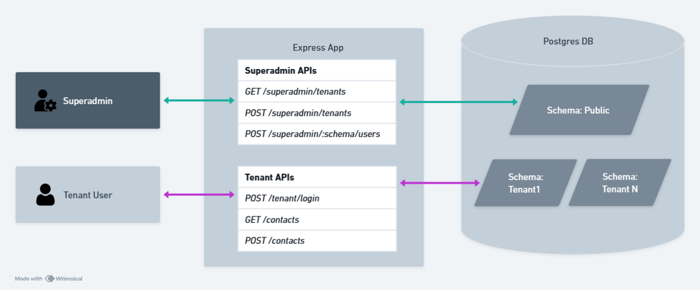
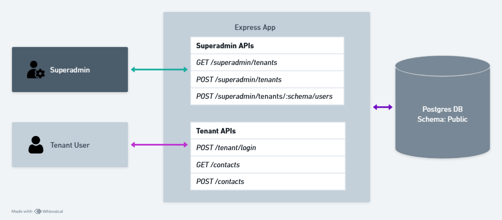

# Multi-Tenant Configurations

This repository demonstrates two different approaches to implementing multi-tenancy in a Node.js/Express application using PostgreSQL and Prisma ORM. It provides working examples of both shared database with separate schemas and shared database with shared schema architectures.

## Overview

Multi-tenancy is an architecture where a single instance of software serves multiple tenants (customers/organizations). This project showcases two common approaches:

### 1. Shared Database with Separate Schemas (`shared-db-seperate-schema`)



In this approach:
- Each tenant gets their own dedicated PostgreSQL schema
- Data is physically isolated at the schema level
- Stronger data isolation and security
- More complex to manage but offers better customization per tenant
- Easier to backup/restore individual tenant data
- Better for compliance requirements where data isolation is crucial

### 2. Shared Database with Shared Schema (`shared-db-shared-schema`)



In this approach:
- All tenants share the same database schema
- Data is logically isolated using a `tenantId` column
- Simpler to manage and maintain
- More efficient resource utilization
- Easier to implement and update
- Better for scenarios where strict data isolation isn't required

## Key Differences

| Feature | Separate Schemas | Shared Schema |
|---------|-----------------|---------------|
| Data Isolation | Physical (schema-level) | Logical (tenantId) |
| Resource Usage | Higher (separate schemas) | Lower (shared tables) |
| Maintenance | More complex | Simpler |
| Customization | Easier per tenant | Limited |
| Backup/Restore | Per tenant possible | All tenants together |
| Performance | May vary per tenant | Consistent across tenants |
| Security | Stronger isolation | Requires careful filtering |

## Project Structure

```
.
├── docker/                     # Docker configuration files
│   └── postgres/              # PostgreSQL initialization scripts
├── media/                     # Architecture diagrams
├── shared-db-seperate-schema/ # Separate schema implementation
└── shared-db-shared-schema/   # Shared schema implementation
```

## Getting Started

### Prerequisites
- Node.js v18+
- PostgreSQL 13+
- Docker & Docker Compose (for local development)

### Running with Docker

1. For Separate Schema Architecture:
```bash
docker compose --profile express-seperate-schema up
```

To stop:
```bash
docker compose --profile express-seperate-schema down
```

2. For Shared Schema Architecture:
```bash
docker compose --profile express-shared-schema up
```

To stop:
```bash
docker compose --profile express-shared-schema down
```

## Features Common to Both Implementations

- **Superadmin Management**
  - Create and list tenants
  - Create users for tenants
  - Secured with admin token

- **Tenant Authentication**
  - JWT-based authentication
  - Secure login endpoints
  - Role-based access control

- **Contact Management**
  - CRUD operations for contacts
  - Tenant-specific data isolation
  - Authenticated endpoints

## When to Choose Which Architecture?

### Choose Separate Schemas When:
- Strict data isolation is required
- Compliance requirements demand physical separation
- Tenants need schema-level customization
- Individual tenant backup/restore is important
- Resources allow for multiple schemas

### Choose Shared Schema When:
- Simple multi-tenancy is needed
- Resource optimization is priority
- Maintenance simplicity is important
- Strict data isolation isn't required
- Rapid deployment and updates are needed

## Detailed Documentation

- [Separate Schema Documentation](shared-db-seperate-schema/README.md)
- [Shared Schema Documentation](shared-db-shared-schema/README.md)

## Contributing

Feel free to submit issues, fork the repository, and create pull requests for any improvements.

## License

This project is licensed under the MIT License - see the [LICENSE](LICENSE) file for details.